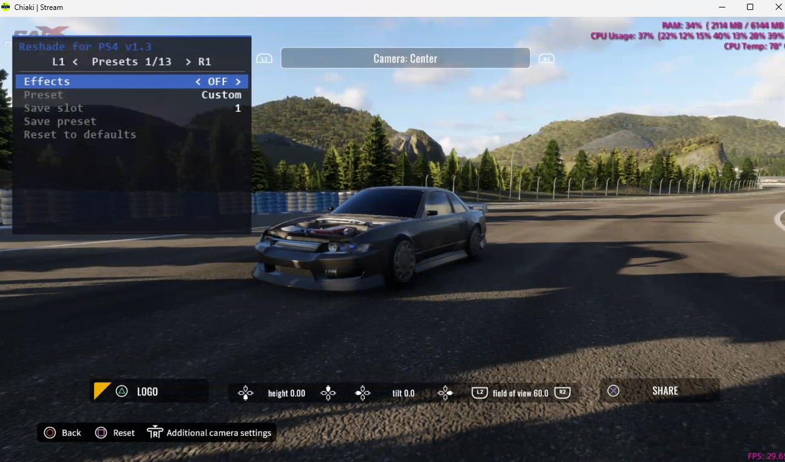
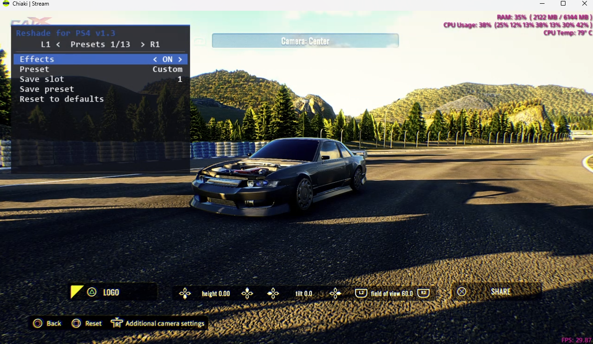
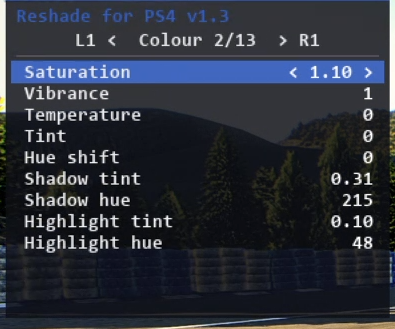
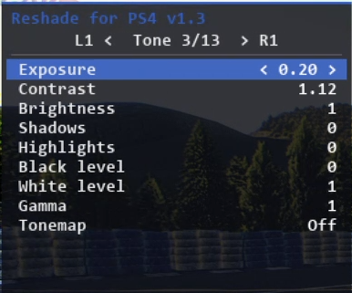
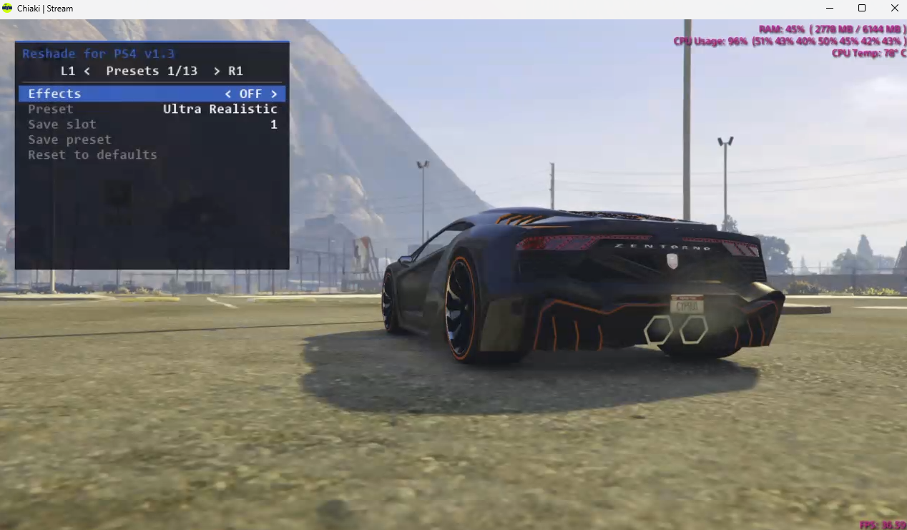
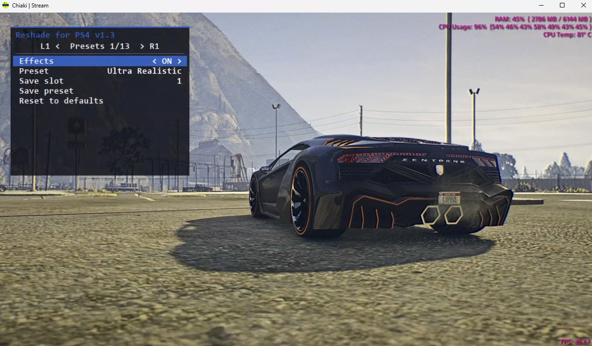

# Reshade-Ps4
Made by toweliee and the assistance of claude
Revised and published by MordecaiOG

# TESTED ON 12.00 and 13.02

Known Working Game Titles

CUSA15633 - CarX

CUSA12398 - The Forest

CUSA00419 - GTA5

CUSA01830 - ASSETTO CORSA

CUSA00265 - Minecraft

++++++++++++
INSTALLATION
++++++++++++

Download Reshade.zip from Release https://github.com/MordecaiOG/Reshade-Ps4/releases/tag/reshade_ps4

place postfx.prx in your goldhen plugins folder
/data/GoldHen/Plugins

postfx_icon.png into /data/GoldHen 

add your title Id into /data/GoldHen/Plugins.ini - example: 

[CUSA00419]

/data/GoldHEN/plugins/postfx.prx

[CUSA00265]

/data/GoldHEN/plugins/postfx.prx

++++++++++++
CONTROLS
++++++++++++

load game and you should get notify it worked

R3 + Dpad Down = Open Menu

R1 - L1 = Change Pages

++++++++++++
PRESETS
++++++++++++

your saved presets can be found in /data/Goldhen/PostFx
and shared with friends and community

+++++++++
*NOTICE*
+++++++++

IF YOU USE 3RD PARTY MULTIPLAYER PLUGINS MAKE SURE YOU LIST PostFx.prx AFTER

+++++++++
IMAGES
+++++++++

